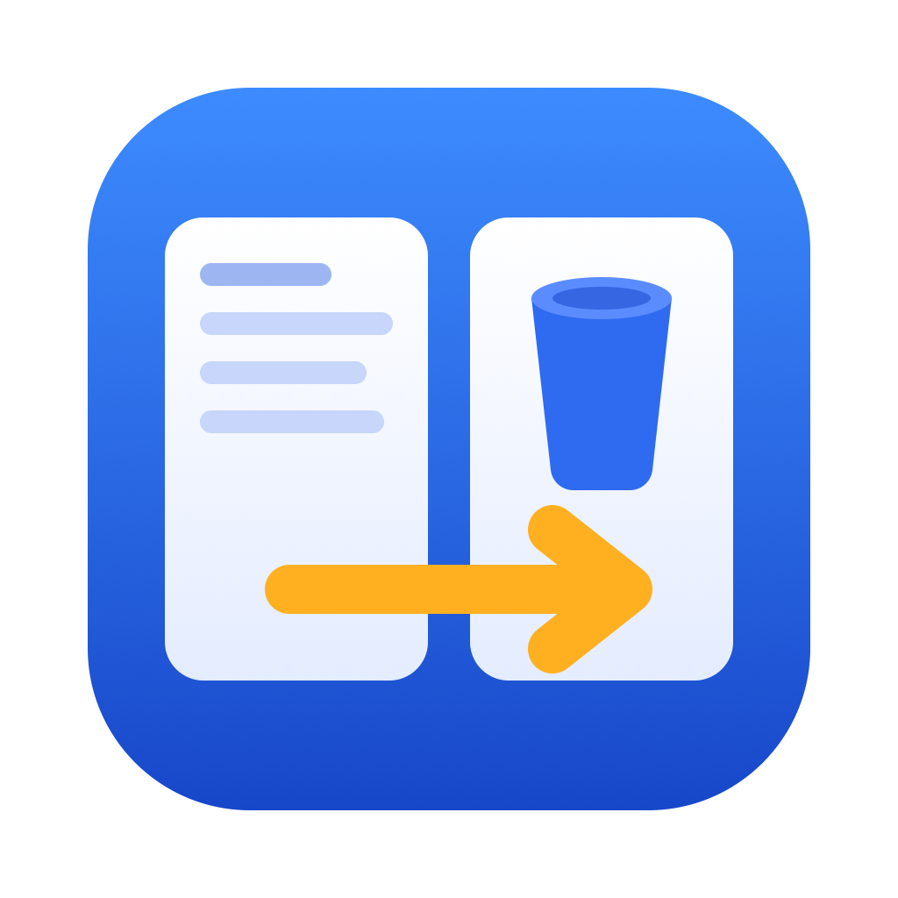
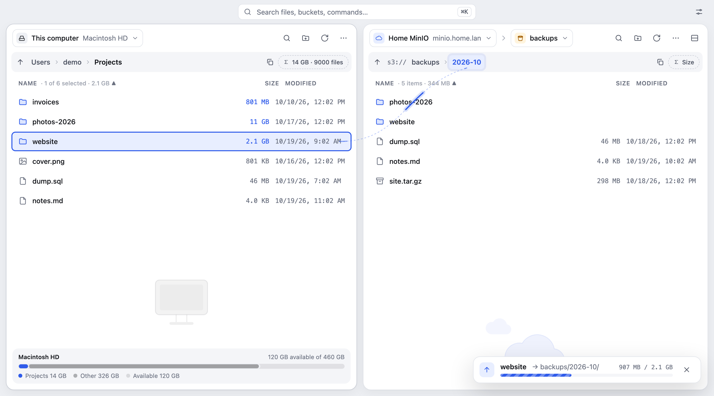

<p align="center">
  
</p>

<h1 align="center">NoExplorer</h1>

<p align="center">
  <b>No explorer needed: just drag it to your bucket.</b><br/>
  A tiny two-pane file manager: your computer on the left, your cloud on the right.<br/>
  S3 (AWS, MinIO, R2, B2, Wasabi…) · Nextcloud · WebDAV · Box &nbsp;—&nbsp; macOS · Windows · Linux
</p>

<p align="center">
  <a href="https://noexplorer.vnappmob.com">Website</a> ·
  <a href="https://noexplorer.vnappmob.com/docs/">Docs</a> ·
  <a href="https://github.com/vnappmob/noexplorer/releases/latest">Download</a> ·
  <a href="docs/DEVELOPMENT.md">Develop</a> ·
  <a href="CHANGELOG.md">Changelog</a>
</p>

---

<p align="center">
  <picture>
    <source media="(prefers-color-scheme: dark)" srcset="assets/screenshot-dark.png" />
    
  </picture>
</p>

## Why

Backing up to a self-hosted MinIO shouldn't take a heavyweight client and a trip into
"advanced settings" to enable path-style requests. With NoExplorer you open the app, drag,
and you're done.

## Features

- **Two panes**: your computer on the left, the bucket on the right. Drag either way to
  upload or download. Drop onto a folder or a breadcrumb to target it.
- **Drop from Finder / Explorer** onto the bucket pane. Folders keep their structure.
- **Fast**: 6 files in parallel; large files use multipart upload with 4 parts in flight.
- **Quick look** with Space: images, video, audio, PDF and text, local or remote.
- **Folder sizes as you browse**, faster than ncdu: every folder on this computer gets its size
  scanned in the background and kept up to date as files change, plus a storage bar showing this
  folder against the whole disk.
- **Safe by design**: the app never permanently deletes or overwrites local files. Downloads that
  would collide become `name (1).ext`, partial downloads never look complete, and removing local
  files means **Move to Trash** (recoverable).
- **Self-hosted friendly**: path-style requests are on by default, and the connection test
  works even when the key can't list buckets.
- **S3, Nextcloud, WebDAV and Box (beta)**, plus Google Cloud Storage, Azure Blob and SFTP as
  experimental options: AWS, R2, B2, Wasabi, MinIO… plus Nextcloud/ownCloud
  (sign in through the browser), any WebDAV server or NAS, and Box with your own app. Previews and
  transfers work the same way everywhere.
- **Compare folders**: after a backup, see exactly what's missing or different on each side.
  Contents are checked by checksum without downloading, system junk (`.DS_Store`…) is explained,
  and one click uploads or downloads the difference.
- **Multiple accounts**: switch between servers from the remote pane header, or straight from
  the menu bar / tray. **Split the remote side** to show up to 3 accounts at once, and drag
  between them to copy from one cloud to another.
- **Runs in the background**: close the window and NoExplorer stays in the menu bar / tray,
  showing transfer progress there.
- **Auto-updates**: new versions install in place with one click.
- **Σ Size** for any folder, local or remote. A path bar always shows where you are.
- Copy a 7-day share link, create folders, delete remote files (in the background, with
  progress), follow and cancel every transfer. Theme and text size settings, resizable panes.
  About a 15 MB download on macOS.

### Experimental

Newer features ship in **Settings → Experimental**, off until you turn them on
([docs](https://noexplorer.vnappmob.com/docs/experimental/)):

- **Rename, move and duplicate** on both sides, with ⌘Z undo. Nothing is ever overwritten.
- **Resumable transfers**: automatic retries, pause, a speed limit, and transfers cut short by
  quitting continue on the next launch.
- **Thumbnail grid** for images and videos, with cached thumbnails (48 MB at most on disk).
- **Tabs, back/forward history and favorites** in each pane.
- **Backup pairs**: save "this folder ↔ that remote folder" and back it up in one click.
- **Self-signed HTTPS**: trust a NAS's own certificate after comparing its fingerprint.
- **More storage**: Google Cloud Storage, Azure Blob Storage and SFTP.

## Install

Download the installer for your OS from the
[latest release](https://github.com/vnappmob/noexplorer/releases/latest) or the
[website](https://noexplorer.vnappmob.com).

| OS | File |
|---|---|
| macOS (Apple Silicon and Intel) | `NoExplorer_x.y.z_universal.dmg`, signed and notarized |
| Windows 10/11 | `NoExplorer_x.y.z_x64-setup.exe` or `.msi` |
| Linux | `.AppImage`, `.deb` or `.rpm` |

> Windows builds aren't code-signed (a certificate costs money every year; see
> [code signing](https://noexplorer.vnappmob.com/docs/code-signing)). If SmartScreen appears,
> click **More info → Run anyway**. Updates are always signed with NoExplorer's own update key.

## Connect

The first time you launch the app it opens **Settings → Accounts**. Add as many accounts as
you like, then switch between them from the picker in the remote pane header.

**Nextcloud / ownCloud:** pick *Nextcloud*, enter your server address and click **Sign in with
Nextcloud…**. Approve in the browser and you're done (NoExplorer gets its own app password, kept
in your system keychain). **WebDAV / NAS:** pick *WebDAV* and enter the folder URL, user name and
password.

**Box (beta):** Box needs your own (free) app, because an open-source app can't ship a secret. In
the [Box Developer Console](https://app.box.com/developers/console): *Create Platform App →
Custom App → User Authentication (OAuth 2.0)*. Set the **Redirect URI** to
`http://127.0.0.1:53682/callback` and tick *Read and write all files and folders*. Then pick *Box*
in NoExplorer, paste the **Client ID** and **Client secret**, and click **Sign in with Box…**.

**S3 and compatible services:**

| Field | Example |
|---|---|
| Provider | Pick yours (AWS, Cloudflare R2, Backblaze B2, Wasabi, DigitalOcean Spaces, or self-hosted). The form then shows what to enter |
| Endpoint | `https://minio.example.com` or `http://192.168.1.10:9000`. **Leave it empty for Amazon S3**: each bucket's region is detected automatically |
| Access key / Secret key | Your MinIO / S3 credentials |
| Region | `us-east-1` (fine for MinIO) |
| Path-style requests | ✓ Leave it on for MinIO and other self-hosted servers |

Click **Test**, then **Save & use**. Secret keys and passwords are stored only on your computer,
in the system credential store (Keychain, Credential Manager or Secret Service).

More in the [docs](https://noexplorer.vnappmob.com/docs/): accounts, transfers, Compare,
shortcuts, FAQ and [privacy](https://noexplorer.vnappmob.com/docs/privacy).

## Keyboard

| Key | Action |
|---|---|
| `Tab` / `←` `→` | Switch pane (Tab also cycles through split remote views) |
| `↑` `↓` (+`Shift`) | Move or extend the selection |
| `Enter` | Open a folder. Remote file: preview. Local file: open in its default app |
| `Space` | Quick look (inside it, `←` `→` go to the previous or next file) |
| `F5` or `⌘/Ctrl + Enter` | Copy the selection to the other pane (upload or download) |
| `Backspace` / `⌘↑` | Up one folder |
| `⌘⌫` / `Delete` | Delete from S3 (asks first) · on this computer: Move to Trash |
| `⌘K` | Command palette: commands, accounts, buckets, places, files |
| `⌘L` | Type a path |
| `⌘\` · `⌘W` | Split the remote side (another account below) · close the focused remote view |
| `⌘R` · `⌘F` · `⌘,` | Refresh · Filter · Settings |
| `F2` · `⌘Z` | Rename · undo the last rename / move / duplicate *(experimental)* |
| `⌘[` `⌘]` · `⌘T` · `Ctrl+Tab` | Back / forward · new tab · next tab *(experimental)* |

## Limitations

- You can't drag files from the app out to Finder/Explorer yet. Drop them in the left pane instead.
- Self-signed HTTPS certificates need the experimental option above (one pinned certificate per
  account); TLS checks are never switched off.
- Copying between two different accounts goes through your computer, one file at a time
  (a copy within one S3 account runs on the server).
- Local files are only ever moved to the Trash, never deleted permanently, on purpose.

See the [roadmap](docs/ROADMAP.md) for what's next.

## Contributing

Pull requests are welcome. Start with [AGENTS.md](AGENTS.md), a one-minute tour of the
codebase, then [CONTRIBUTING.md](CONTRIBUTING.md).

```bash
npm install
./scripts/dev-s3.sh up && ./scripts/dev-s3.sh seed   # local S3 in Docker
npm run tauri dev
```

## License

[MIT](LICENSE) © 2026 Kris Luu (VNAppMob)
